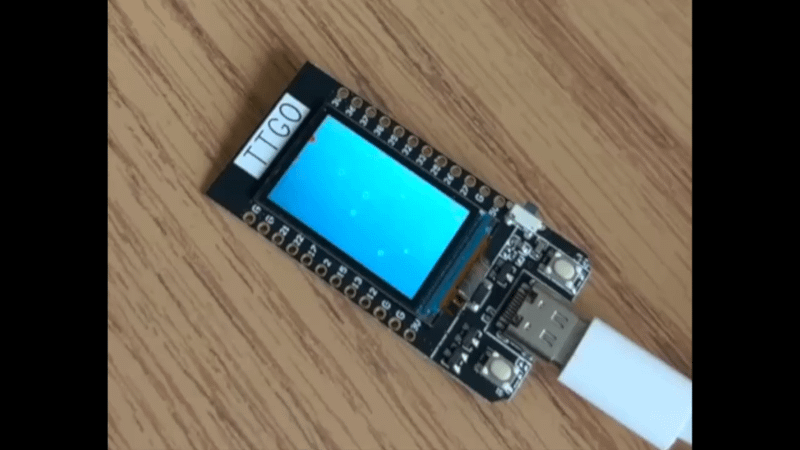
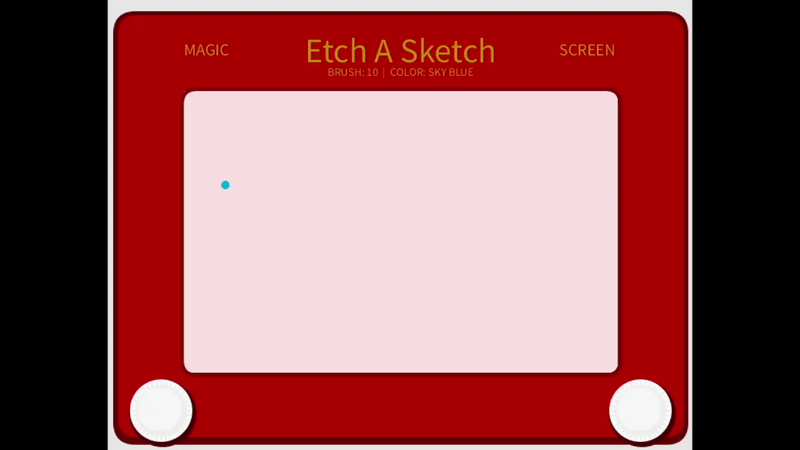
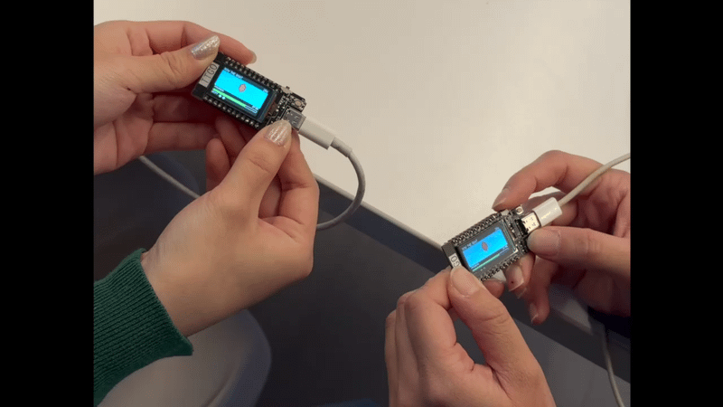

# Project Documentation

 A collection of projects I’ve created for my Creative Embedded Systems course, exploring physical computing, interaction design, and creative technology. 

  <a href="projects/ocean-generative-art.html" class="project-card">
    
    

      01 / GENERATIVE ART
      <h2>Ocean Generative Art</h2>
      
An interactive underwater world design created with an ESP32, TFT display, and Arduino, featuring swimming fishes, bubbles, and a shark.

      Explore Project ↗
    

  </a>

  <a href="projects/digital-etch-a-sketch.html" class="project-card">
    
    

      02 / INTERACTIVE DEVICES
      <h2>Digital Etch A Sketch</h2>
      
An interactive digital Etch A Sketch built with an ESP32, joystick, push button, potentiometer, and Processing.

      Explore Project ↗
    

  </a>

  <a href="projects/row-the-boat.html" class="project-card">
    
    

      03 / DISTRIBUTED COMMUNICATION
      <h2>Row the Boat</h2>
      
A two-player cooperative rowing game built with two ESP32 boards, Arduino, and ESP-NOW.

      Explore Project ↗
    

  </a>

