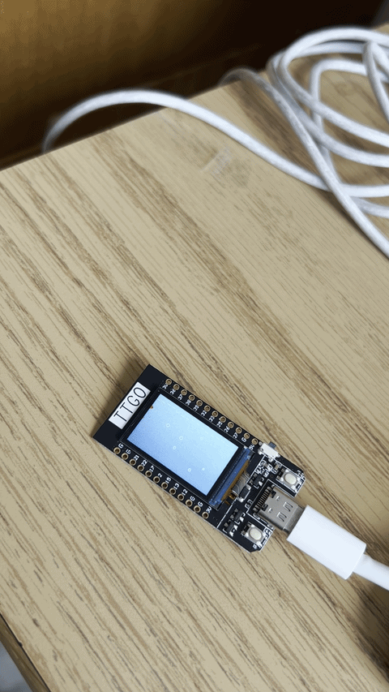

# Project Documentation

\
⋆⭒˚.⋆ A collection of projects exploring physical computing, interaction design, and creative technology. ⋆⭒˚.⋆\

\

&#x20; \<a href="projects/ocean-generative-art.html" class="project-card">     \     \
       \01 / CREATIVE COMPUTING\       \<h2>Ocean Generative Art\</h2>       \
An interactive underwater world created with an ESP32 display, featuring swimming fish, bubbles, and a shark.\
       \Explore Project ↗\     \
   \</a>

&#x20; \<a href="projects/digital-etch-a-sketch.html" class="project-card">     \     \
       \02 / INTERACTIVE DESIGN\       \<h2>Digital Etch A Sketch\</h2>       \
A digital drawing experience using an ESP32, joystick, potentiometer, and physical button.\
       \Explore Project ↗\     \
   \</a>

&#x20; \<a href="projects/row-the-boat.html" class="project-card">     \     \
       \03 / DISTRIBUTED COMMUNICATION\       \<h2>Row the Boat\</h2>       \
A two-player cooperative game inspired by a three-legged race, built using two ESP32 T-Display boards.\
       \Explore Project ↗\     \
   \</a>

\

