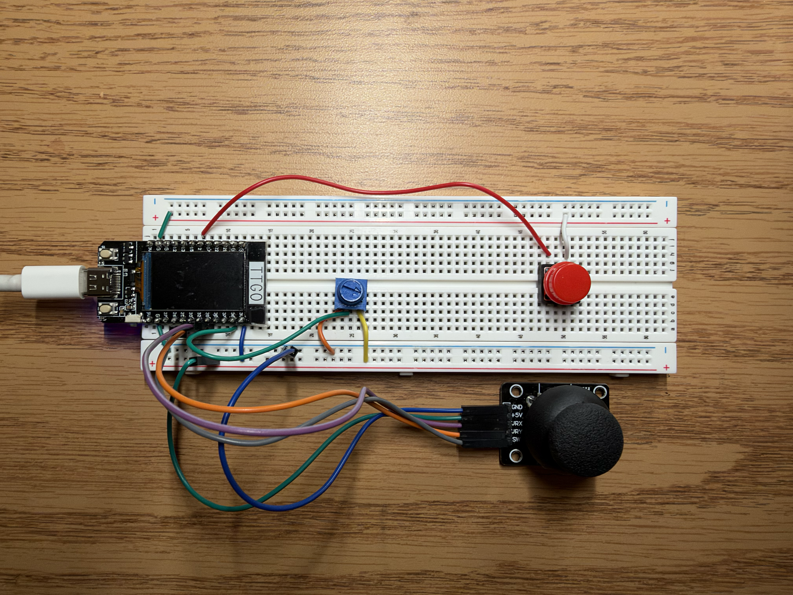

# Project Documentation

<p class="intro-text">⋆⭒˚.⋆ This page holds my project documentation for Creative Embedded Systems this semester! ⋆⭒˚.⋆</p>

---

## Project 1: Ocean Generative Art

### Artistic Vision

For this project, I wanted to create a small underwater environment that felt calm and playful but still had a moment of surprise. I designed the physical installation as an aquarium ocean exhibit ticket made from a paper envelope. The cutout in the ticket frames the TFT display, making the screen feel like a window into the ocean.

My goal was for the viewer to feel like they were looking through an aquarium ticket and seeing a small underwater world inside it. I wanted the animation to feel like a living environment rather than just objects moving randomly.

### Design Decisions

I chose to use a blue ocean gradient that becomes darker toward the bottom to create depth. I also added small moving wave lines at the top of the screen to make the water look like it's moving.

The fish were designed to be randomized in size, color, position, and speed so that the scene would feel less repetitive. I also added bubbles that slowly rise through the water.

The biggest design decision was the shark interaction. I wanted the shark to create a sudden change in the calm environment. When the shark gets close to the fish, they instantly turn around and swim away at a much faster speed. Once the shark leaves the screen, the fish return and the calm environment continues.

For the physical installation, I used a paper envelope with a cutout for the display. This made the screen feel like an aquarium window while the envelope itself became part of the design.

### Technical Process

I programmed the project using an ESP32 and TFT display in Arduino. I used the TFT_eSPI and SPI libraries to control the display.

The animation uses a sprite buffer so the ocean, fish, bubbles, and shark can be drawn before being pushed to the screen. This helped the animation look smoother since a lot of the elements were moving at the same time.

The fish are controlled using arrays for their position, size, speed, direction, and color. They normally swim across the screen and wrap around when they reach the edge. When the shark becomes active, the fish change direction and move faster.

### Technical Challenges

One challenge was getting multiple animated elements to move smoothly at the same time. I used a sprite buffer to draw the full scene before displaying it, which helped reduce visual flickering.

Another challenge was making the shark interaction noticeable. At first, simply having the shark swim across the screen did not make it feel like part of the environment. I changed the behavior so that the fish react when the shark gets close. They immediately turn around and swim away faster, making the shark feel like it actually affects the environment.

### Physical Installation

The TFT display is placed behind a cutout in a paper envelope so that the screen becomes the ocean portion of the aquarium ticket. The ESP32 and LiPo battery are kept behind the envelope. I decorated the front of the envelope to make it look like an aquarium ocean exhibit ticket.

### Visual Documentation

<h4>Final Module 1 Project Video</h4>

<div class="project-video">
  <video autoplay muted loop playsinline controls>
    <source src="video/demo.video.mp4" type="video/mp4">
    Your browser does not support the video tag.
  </video>
</div>

<h4>Installation Photos</h4>

<div class="project-media">
  
</div>

<div class="project-media">
  
</div>

<div class="project-media">
  
</div>

### Project Repository

[Click for Ocean Generative Art GitHub repository](https://github.com/Sanjidahjahan/Ocean-Generative-Art)

---

## Project 2: Digital Etch A Sketch

### Artistic Vision

For this project, I wanted to recreate the original Etch A Sketch but give it a digital twist. I liked the idea of taking a familiar childhood toy and making it interactive using physical controls and a computer screen.

I kept the red frame of the original Etch A Sketch but gave the interface a different look with a pink-toned drawing area and different details for the brush size and color settings.

My goal was to make drawing simple and fun. Instead of using a mouse, users can move a joystick to draw on the screen, change the brush size, switch colors, and clear their drawing using the other physical controls.

### Design Decisions

One of my main design decisions was keeping the familiar look of the original Etch A Sketch while changing how users interact with it. I chose a red frame and a pink-toned drawing area to give the digital version its own style.

<h4>Drawing Interface and Controls</h4>

<div class="project-video">
  <video autoplay muted loop playsinline controls>
    <source src="Etch-a-sketch-demo.mp4" type="video/mp4">
    Your browser does not support the video tag.
  </video>
</div>

Since the project required using physical controls, I used the joystick to move the drawing cursor and clicking it to change between three brush sizes: 4, 7, and 10. The potentiometer switches between five drawing colors, and the separate yellow button clears the screen.

I also added an indicator on the screen to show the selected brush size and color. This makes it easier for users to see which settings they are using while drawing.

<h4>Changing Colors and Brush Sizes</h4> 

<div class="project-video">
  <video autoplay muted loop playsinline controls>
    <source src="Etch-a-sketch-colors-brush.mp4" type="video/mp4">
    Your browser does not support the video tag.
  </video>
</div>

### Technical Process

I built the project using an ESP32 TTGO T-Display, Arduino IDE, and Processing. The ESP32 connects to a joystick, push button, and potentiometer. The Arduino code reads the controls and sends their values to Processing through serial communication.

The Arduino code reads the joystick's X and Y positions, the joystick click, the push button, and the potentiometer value. It sends these five values to Processing in one comma-separated line. Processing reads those values and uses them to control the drawing interface.

One part of my Processing code controls how the joystick moves the drawing cursor:

```java
float speedX = map(joyX, 0, 4095, -6, 6);
float speedY = map(joyY, 0, 4095, -6, 6);

if (abs(joyX - 2048) < 350) speedX = 0;
if (abs(joyY - 2048) < 350) speedY = 0;

penX = constrain(penX + speedX, 0, screenW - 1);
penY = constrain(penY + speedY, 0, screenH - 1);
```

This code uses the joystick readings to control the cursor's movement. The dead zone keeps the cursor from moving when the joystick is not being touched, and `constrain()` keeps it inside the drawing area.

I also used a PGraphics layer in Processing so the lines stay on the screen while the rest of the interface updates.

<h4>Final Module 2 Project Video</h4>

<div class="project-video">
  <video autoplay muted loop playsinline controls>
    <source src="ESP32_demo.mp4" type="video/mp4">
    Your browser does not support the video tag.
  </video>
</div>

### Technical Challenges

One challenge was getting the ESP32 and Processing to communicate correctly. I had to troubleshoot the serial connection between my ESP32 and Mac, along with some of the potentiometer readings.

Another challenge was making the brush sizes easier to tell apart. At first, the differences were not very noticeable, so I adjusted them to three sizes: 4, 7, and 10. I also added an indicator to show the selected brush size and color.

I tested the controls and made changes to the code and interface until everything worked the way I wanted.

### Physical Setup

The physical setup uses an ESP32 TTGO T-Display, joystick, potentiometer, yellow push button, breadboard, and jumper wires. The joystick moves the drawing cursor and changes the brush size when clicked. The potentiometer switches between colors, and the yellow button clears the drawing.

The ESP32 connects to my Mac through USB and sends the control inputs to the Processing application. This allows the physical components to control the digital drawing interface.

<h4>Hardware Setup</h4>

<div class="project-media">
  
</div>

### AI Support Used

I used ChatGPT (GPT-6) for coding assistance and troubleshooting during this project. It helped me understand parts of my Arduino and Processing code, work through hardware and serial connection issues, and make improvements to the drawing interface.

Some examples of prompts I used were: "Why does my Mac show the cu.usbserial port as disconnected, even though my ESP32 was connecting and working before?" and "How can I make the different brush sizes in my Processing sketch more visible while keeping the drawing experience the same?"

I also asked, "What code should I add to my original Processing sketch so the lines stay on the screen while the rest of the interface updates?" This helped me work with a PGraphics layer to keep the drawing visible as the interface updates.&#x20;

I used the suggestions to troubleshoot and make changes, then tested the code and hardware to see what worked for my project.

### Project Repository

[Click here to view the Digital Etch A Sketch GitHub repository](https://github.com/Sanjidahjahan/Digital-Etch-a-Sketch)
