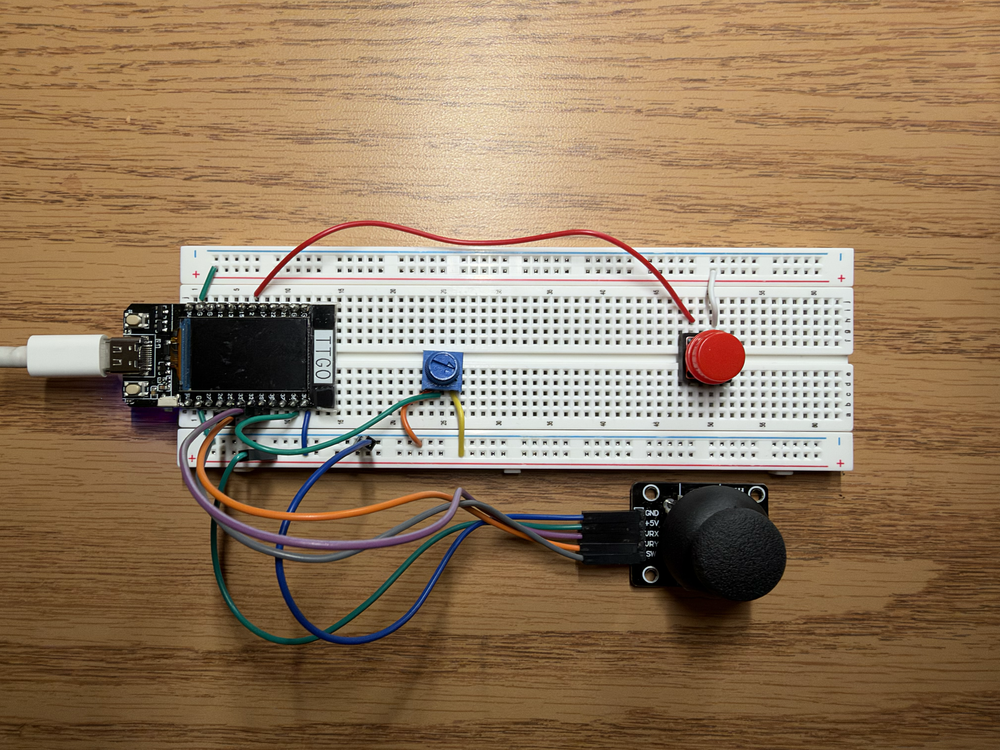

### Artistic Vision

For this project, I wanted to recreate the original Etch A Sketch but give it a digital twist. I liked the idea of taking a familiar childhood toy and making it interactive using physical controls and a computer screen.

I kept the red frame of the original Etch A Sketch but gave the interface a different look with a pink-toned drawing area and different details for the brush size and color settings.

My goal was to make drawing simple and fun. Instead of using a mouse, users can move a joystick to draw on the screen, change the brush size, switch colors, and clear their drawing using the other physical controls.

### Design Decisions

One of my main design decisions was keeping the familiar look of the original Etch A Sketch while changing how users interact with it. I chose a red frame and a pink-toned drawing area to give the digital version its own style.

<h4>Drawing Interface and Controls</h4>

<div class="project-video">
  <video autoplay muted loop playsinline controls>
    <source src="../Etch-a-sketch-demo.mp4" type="video/mp4">
    Your browser does not support the video tag.
  </video>
</div>

Since the project required using physical controls, I used the joystick to move the drawing cursor and clicking it to change between three brush sizes: 4, 7, and 10. The potentiometer switches between five drawing colors, and the separate yellow button clears the screen.

I also added an indicator on the screen to show the selected brush size and color. This makes it easier for users to see which settings they are using while drawing.

<h4>Changing Colors and Brush Sizes</h4> 

<div class="project-video">
  <video autoplay muted loop playsinline controls>
    <source src="../Etch-a-sketch-colors-brush.mp4" type="video/mp4">
    Your browser does not support the video tag.
  </video>
</div>

### Technical Process

I built the project using an ESP32 TTGO T-Display, Arduino IDE, and Processing. The ESP32 connects to a joystick, push button, and potentiometer. The Arduino code reads the controls and sends their values to Processing through serial communication.

The Arduino code reads the joystick's X and Y positions, the joystick click, the push button, and the potentiometer value. It sends these five values to Processing in one comma-separated line. Processing reads those values and uses them to control the drawing interface.

One part of my Processing code controls how the joystick moves the drawing cursor:

```java
float speedX = map(joyX, 0, 4095, -6, 6);
float speedY = map(joyY, 0, 4095, -6, 6);

if (abs(joyX - 2048) < 350) speedX = 0;
if (abs(joyY - 2048) < 350) speedY = 0;

penX = constrain(penX + speedX, 0, screenW - 1);
penY = constrain(penY + speedY, 0, screenH - 1);
```

This code uses the joystick readings to control the cursor's movement. The dead zone keeps the cursor from moving when the joystick is not being touched, and `constrain()` keeps it inside the drawing area.

I also used a PGraphics layer in Processing so the lines stay on the screen while the rest of the interface updates.

<h4>Final Module 2 Project Video</h4>

<div class="project-video">
  <video autoplay muted loop playsinline controls>
    <source src="../ESP32_demo.mp4" type="video/mp4">
    Your browser does not support the video tag.
  </video>
</div>

### Technical Challenges

One challenge was getting the ESP32 and Processing to communicate correctly. I had to troubleshoot the serial connection between my ESP32 and Mac, along with some of the potentiometer readings.

Another challenge was making the brush sizes easier to tell apart. At first, the differences were not very noticeable, so I adjusted them to three sizes: 4, 7, and 10. I also added an indicator to show the selected brush size and color.

I tested the controls and made changes to the code and interface until everything worked the way I wanted.

### Physical Setup

The physical setup uses an ESP32 TTGO T-Display, joystick, potentiometer, yellow push button, breadboard, and jumper wires. The joystick moves the drawing cursor and changes the brush size when clicked. The potentiometer switches between colors, and the yellow button clears the drawing.

The ESP32 connects to my Mac through USB and sends the control inputs to the Processing application. This allows the physical components to control the digital drawing interface.

<h4>Hardware Setup</h4>

<div class="project-media">
  
</div>

### AI Support Used

I used ChatGPT (GPT-6) for coding assistance and troubleshooting during this project. It helped me understand parts of my Arduino and Processing code, work through hardware and serial connection issues, and make improvements to the drawing interface.

Some examples of prompts I used were: "Why does my Mac show the cu.usbserial port as disconnected, even though my ESP32 was connecting and working before?" and "How can I make the different brush sizes in my Processing sketch more visible while keeping the drawing experience the same?"

I also asked, "What code should I add to my original Processing sketch so the lines stay on the screen while the rest of the interface updates?" This helped me figure out how to use a separate drawing layer so new lines would stay visible instead of disappearing whenever the interface refreshed.

I used the suggestions to troubleshoot and make changes, then tested the code and hardware to see what worked for my project.

### Project Repository

[Click here to view the Digital Etch A Sketch GitHub repository](https://github.com/Sanjidahjahan/Digital-Etch-a-Sketch)
