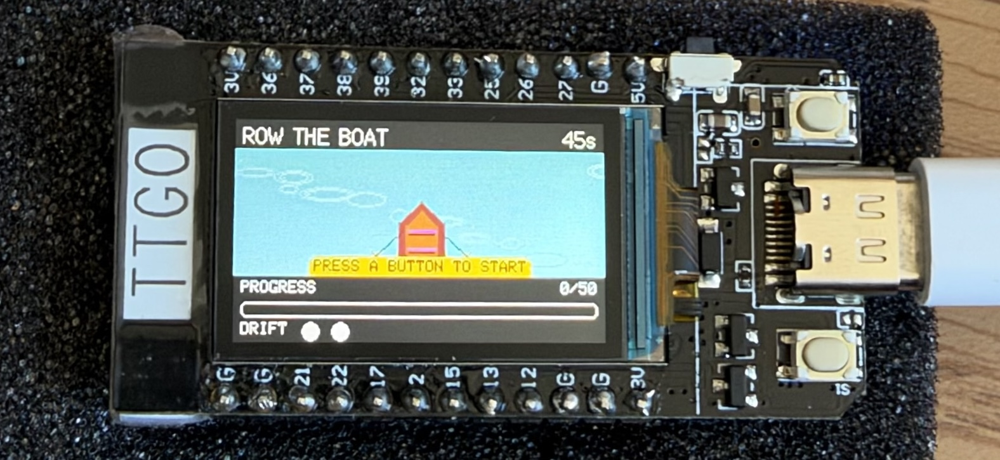
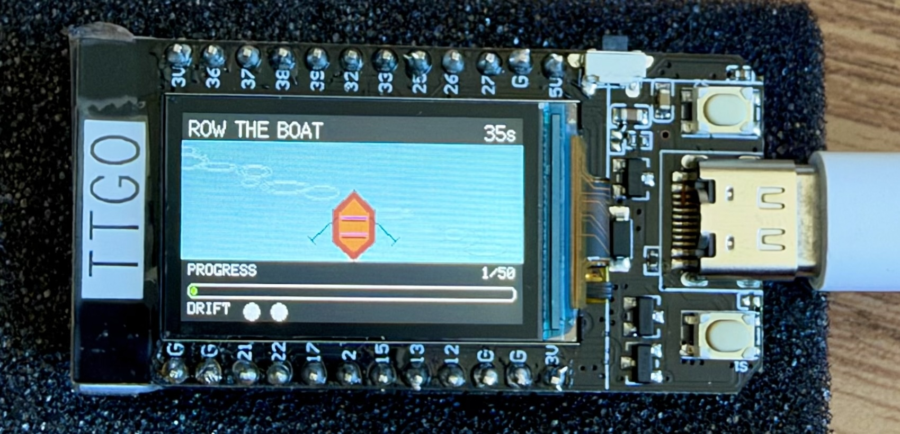
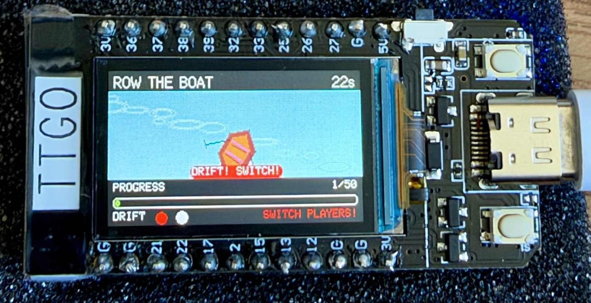
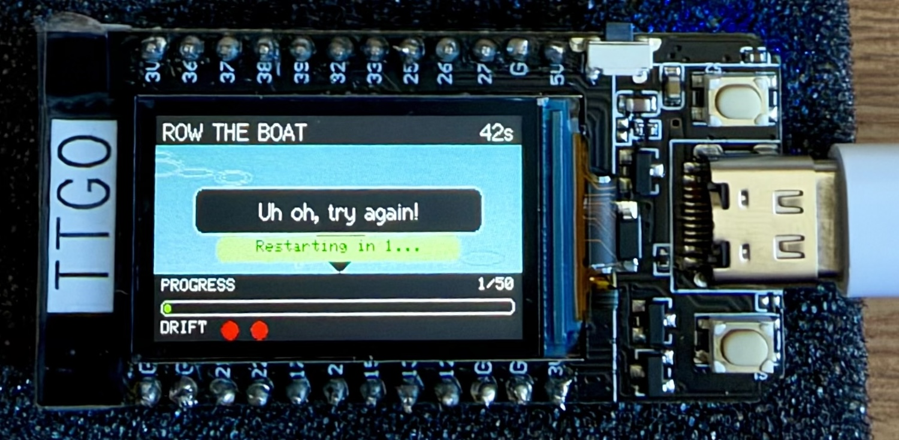

### Artistic Vision

For this project, we wanted to create a two-player cooperative game where both players had to work together to reach the finish line. We came up with the idea of rowing a boat across a lake, inspired by the coordination needed in a three-legged race.

Our goal was to make the game fun but also require players to pay attention to each other's timing. Players take turns pressing their buttons to move the boat forward. If they do not alternate correctly, the boat starts drifting, making it harder to reach the finish line without capsizing.

We wanted the game to have a cartoon-like look. We chose a bird's-eye view of a wooden boat on a lake, with moving ripples on the water to make the visuals feel real.

### Design Decisions

One of our main design decisions was making the game cooperative instead of competitive. Both players have to work together and take turns pressing their buttons to move the boat forward. We liked this idea because it encourages teamwork and communication, since neither player can reach the finish line on their own.

For the visual design, we wanted players to understand what was happening on the screen without needing to read instructions constantly. We added a progress bar to show how close the boat was to the finish line and used different boat movements to show when it started drifting or capsizing.

We also added different messages for each game outcome, including "You made it!", "Time's up!", and "Uh oh, try again!" This makes it easier for players to understand when they win, run out of time, or capsize.

The starting screen introduces the game before players begin:



During gameplay, players can see the boat, water, and progress bar as they work together to reach the finish line:



**My Role (Sanjidah):** I mainly handled Player 1's ESP32, which acted as the host and controlled the main game logic. This included processing button presses, tracking the boat's progress and drift, managing the timer, and keeping both boards updated. I also focused on the screen animations and making the gameplay run smoothly.

**Nicole's Role:** Nicole mainly handled Player 2's ESP32 and its wireless communication with the host. This involved sending button presses through ESP-NOW and receiving game updates so both screens stayed synchronized. She also helped test the connection between the boards and make sure everything worked correctly during gameplay.

**Shared Design Decisions:** We worked together on the overall game concept, alternating button mechanic, drift and capsizing system, and visual style. We also tested the game together and made adjustments based on how it felt to play.

### Technical Process

We built the game using two ESP32 T-Display boards and Arduino IDE. We used ESP-NOW to allow the two boards to communicate wirelessly without needing Wi-Fi.

Player 1's board is the host and manages the main game logic, including the progress, drift, timer, and game status. Player 2's board sends its button presses to Player 1, which processes the inputs and sends the updated game state back to both boards.

Both boards use the same Arduino sketch but have different player IDs. This allows each board to have a different role while keeping both screens updated with the same game information.

One of the most important parts of our code is `processPress(int player)`. This function handles each player's button press and determines whether the boat moves forward, starts drifting, or capsizes.

Here is the function from the `Module_3.ino` file:

```cpp
void processPress(int player) {
  if (PLAYER_ID != 0 || gameOver) return;

  // Start timer with the first press.
  if (!gameStarted) {
    gameStarted = true;
    gameStatus = PLAYING;
    gameStartTime = millis();
  }

  // Same player presses twice.
  if (player == lastPlayer) {
    drift++;

    // Capsize after two drift points.
    if (drift >= MAX_DRIFT) {
      lastPlayer = player;

      endGame(CAPSIZED);
      return;
    }
  }
  // Different player presses.
  else {
    // Correcting drift does not add progress.
    if (drift > 0) {
      drift--;
    } else {
      progress++;
    }
  }

  lastPlayer = player;

  // Check for victory.
  if (progress >= FINISH_DISTANCE) {
    progress = FINISH_DISTANCE;

    endGame(WON);
    return;
  }

  needsRedraw = true;

  sendState();
}
```

The function first checks that it is running on Player 1's board, since Player 1 is responsible for managing the game. The timer also starts when the first player presses a button.

If the same player presses twice in a row, the drift increases. If the other player presses next, the drift decreases instead of increasing the progress. Once the drift reaches 2, the boat capsizes, and the game ends. If players successfully alternate while there is no drift, the progress increases by one. Once the progress reaches 50, the players win.

After processing each press, the function marks the screen for an update and sends the latest game state to both boards using `sendState()`. This keeps both players' displays synchronized throughout the game.

### Technical Challenges

One of our main challenges was getting both ESP32 boards to communicate correctly and stay synchronized. We had to make sure that Player 2's button presses were received by Player 1 and that both screens displayed the same game state. We tested the communication between the boards and adjusted the message handling until the updates were working correctly.

Another challenge was getting the alternating button and drift mechanics to work the way we wanted. We had to test different button sequences to make sure the boat moved forward when players took turns, drifted when they pressed out of order, and capsized when the drift reached its limit.

This image shows what happens when players press out of order, and the boat starts drifting:



If the drift reaches its limit, the boat capsizes and the round ends:



We also had an issue with the screen flashing whenever a player pressed a button. At first, the display was being refreshed too much during gameplay. We changed the drawing logic to use needsRedraw to keep track of when the screen needed to be updated. Instead of refreshing the entire screen, we selectively redrew only the parts that changed, such as the boat, water, and game information. This made the movement look smoother and removed the flashing during button presses.

Here is a video showing two players playing Row the Boat:

```html
<div class="project-video">
  <video controls playsinline width="100%">
    <source src="../video/game-demo.mp4" type="video/mp4">
    Your browser does not support the video tag.
  </video>
</div>
```

### AI Support Used

We used ChatGPT (GPT-6) for coding assistance and troubleshooting throughout the project. It helped us understand parts of the professor's original ESP-NOW starter code and figure out how to adapt it for our cooperative game.

Two examples of prompts we used were:

- "Which function is causing the screen to flash when a button is pressed, and how can we change it so there are no flashes?"
- "How can we make sure both ESP32 boards display the same game state when one player presses a button?"

We used the explanations to better understand the code and make our own adjustments. We then uploaded the sketch to both boards and tested the changes together, making further adjustments whenever something didn't work as expected.

### Project Repository

[Click here to view the Row the Boat GitHub repository](https://github.com/Sanjidahjahan/Row-the-boat)
